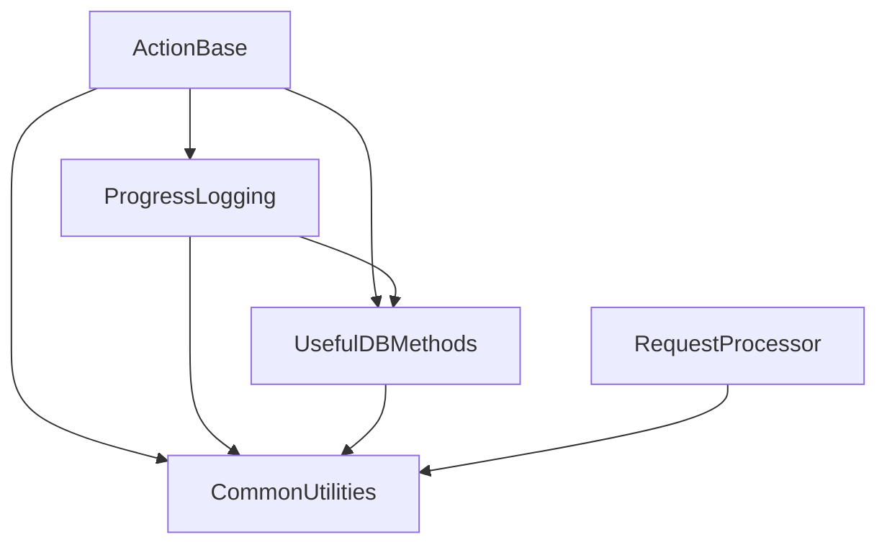

# Plan to remove circular dependencies

Status: proposed refactor only. No source or project changes have been made.

## Recommendation

Keep the five assemblies. Make CommonUtilities the bottom layer, UsefulDBMethods the layer for database-backed application helpers, ProgressLogging the layer for progress logging, and ActionBase the layer for API configuration and action orchestration. RequestProcessor remains a separate dispatcher above CommonUtilities.

Move the reporting code and database folder lookups out of CommonUtilities. Separate the EVENT_VIEWER database writer from its general logging entry points. Supply that writer and ProgressLogging with connection information from the application at startup, instead of allowing either lower layer to call back into ActionBase's configuration types.

This requires three whole-file moves, one small class split, extraction of one private database writer, and two narrow configuration hooks. It avoids adding assemblies, moving the API configuration system, or changing every progress logging method signature. All consuming applications must be rebuilt and their startup paths reviewed.

## Current dependencies and their causes

An arrow means “references/depends on.” The project files currently use DLL references with old HintPath values; these represent real source dependencies even though they are not ProjectReference entries.

| Reference | Evidence and reason |
| --- | --- |
| ActionBase → CommonUtilities | API settings parsing, request conversions, Firebird access and event logging. |
| ActionBase → ProgressLogging | Action setup and logging wrappers use ProgressLogging and its enums. |
| CommonUtilities → ActionBase | WindowsEventLoggingUtilities.LogEventViewerRecord calls CommonDBMethods.Common.ConnectionString at WindowsEventLoggingUtilities.cs:142. CommonDBMethods is compiled into ActionBase. |
| CommonUtilities → UsefulDBMethods | ReportUtilities, SystemReportUtilities, four FolderHelpers lookup methods, and the EVENT_VIEWER writer call database helpers. |
| UsefulDBMethods → CommonUtilities | Database helpers use FirebirdUtilities, FbParameterItem and WindowsEventLoggingUtilities. |
| ProgressLogging → ActionBase | Two active calls to CommonDBMethods.Common.ConnectionString, at ProgressLogging.cs:248 and :989. |
| ProgressLogging → CommonUtilities / UsefulDBMethods | Logging uses common utilities, generators and database execution helpers. |
| RequestProcessor → CommonUtilities | Event logging and utility access; no source dependency on ActionBase is required by the current dispatcher. |

The direct cycles are ActionBase ↔ CommonUtilities, ActionBase ↔ ProgressLogging, and CommonUtilities ↔ UsefulDBMethods. Removing the reverse references below also removes the longer cycles through these assemblies.

## Proposed assembly boundaries

| Assembly | Responsibilities after refactoring | Direct references to other core assemblies |
| --- | --- | --- |
| CommonUtilities | General utilities; existing low-level Firebird primitives; general logging entry points and Windows Event Log fallback. | None |
| UsefulDBMethods | Existing database helpers; database-backed reports and their DTOs; company folder settings queries; EVENT_VIEWER database writer. | CommonUtilities |
| ProgressLogging | Progress logging, response/log content, its existing enums, SQLite logging and Firebird progress records. | CommonUtilities, UsefulDBMethods |
| ActionBase | API settings, request common types, settings-aware CommonDBMethods, action behavior, and a small optional startup helper to wire logging. | CommonUtilities, ProgressLogging, UsefulDBMethods (the last is new, for startup wiring) |
| RequestProcessor | Plugin discovery, request dispatch and existing dispatcher logging. | CommonUtilities |

Build CommonUtilities first, then UsefulDBMethods, then ProgressLogging, then ActionBase. RequestProcessor can build any time after CommonUtilities. Framework and third-party references are omitted from this diagram.

Keeping FirebirdUtilities in CommonUtilities is deliberate: moving it and its public parameter types would greatly expand this refactor. The existing database primitives stay together; higher-level queries and workflows move together into UsefulDBMethods. A separate database primitives assembly can be considered later, but is unnecessary to remove these cycles.

## Specific changes

### 1. Move database-backed reports together

Move these project-owned files from CommonUtilities into a Reporting folder in UsefulDBMethods:

- ReportUtilities.cs
- SystemReportUtilities.cs
- ReportClasses.cs, including GeneralReportParameters and EAReportGetDefaultItem

Use the namespace UsefulDBMethods.Reporting for these moved types. Preserve class names, signatures, SQL, report output and behavior. Add imports for CommonUtilities where the moved files previously relied on their own namespace to find general utilities and Firebird types. Move the report DTOs with their consumers rather than leaving report-specific types in the foundation assembly.

This is a small, intentional namespace change to make ownership clear to developers updating callers. Do not leave forwarding wrappers in CommonUtilities: such wrappers would require the reverse reference again. Preserve database parameter handling and error behavior during the move; fix unrelated report defects separately.

### 2. Split FolderHelpers by responsibility

Keep CommonUtilities.FolderHelpers.GetAssemblyDirectoryName in CommonUtilities. General utility callers, including UtilityApps and logging, still need it without depending on UsefulDBMethods.

Move the following four methods, with their existing signatures and implementations, into a new UsefulDBMethods.CompanyFolderSettings class in UsefulDBMethods:

- DocsLocation
- ImportStorageLocation
- TestRPOLocation
- EAOfficeServiceLocation

These methods query EACompanySettings; they are database settings lookups rather than general filesystem helpers. Update the calls in the moved SystemReportUtilities and all external consumers. No partial class across assemblies and no CommonUtilities wrappers: either would fail to establish the intended boundary.

### 3. Separate EVENT_VIEWER storage from general logging

Keep the existing WindowsEventLoggingUtilities public entry points, message formatting, level conversion and Windows Event Log error writer in CommonUtilities. Extract the database portion of its private LogEventViewerRecord method into a new UsefulDBMethods.EventViewerLogging class. That class takes an explicit connection string plus the existing level, source, event ID and message values, and returns the current error string convention. It owns generation of EVENT_VIEWER_ID_GEN, INSERT INTO EVENT_VIEWER and existing parameter encoding.

Give WindowsEventLoggingUtilities a single configurable callback for writing an event record. Define its named delegate in CommonUtilities using only string/int arguments and a string error return; do not expose APISettingsItem, ProgressLogging or UsefulDBMethods types in this contract. A delegate is sufficient; no dependency injection framework or new contracts assembly is needed.

Retain the Event_Viewer.txt existence check in CommonUtilities before invoking the callback. Today it is evaluated relative to the executing CommonUtilities assembly. Moving that check with the database writer would silently change its base directory to UsefulDBMethods. Preserve the current path and gating behavior explicitly.

The host registers a callback that obtains the connection string and calls UsefulDBMethods.EventViewerLogging. CommonUtilities invokes the delegate without referencing its implementation assembly. This is runtime composition, not an assembly reference back up the graph.

Define the lifecycle and failure rules during implementation:

- Configure once before worker threads, request dispatch or database work begin. Do not overwrite the callback during individual ActionBase construction or per-request Setup calls.
- The marker file absent means no database event write, as today. Marker present with no writer configured must produce an explicit configuration error, using the existing error return/fallback path; it must not silently discard enabled logging.
- Keep WriteToErrorEvent independent of the database callback so initialization and database failures can still be reported.
- Protect callback execution with a per-thread reentrancy guard cleared in a finally block. Connection providers or database helpers may themselves produce information logs; nested logging must bypass the database sink and use the independent fallback. Catch provider/sink exceptions and return/report them without calling the same sink recursively.
- Preserve the current level values, IDs, timestamps and ASCII message encoding in the extracted writer. Any encoding improvement is a separate behavior change.

After these extractions, remove CommonUtilities' references to ActionBase and UsefulDBMethods and remove imports that depended on them. A search of active code must confirm no remaining uses; changing only the project references is insufficient.

### 4. Supply ProgressLogging with its connection provider

Add one startup configuration method to ProgressLogging accepting a Func<string> connection string provider. Replace the two active CommonDBMethods.Common.ConnectionString calls at lines 248 and 989 with calls through that configured provider. Keep the existing public logging overloads, GeneralResponseStatus and JsonContentEntryType in ProgressLogging.

Only Firebird paths that currently obtain an implicit connection string need the provider. Leave explicit-connection overloads and SQLite behavior alone. An unconfigured, empty or failing provider must return a useful error through the existing result/out-error convention when a Firebird write is requested. Paths with logging disabled must retain their existing behavior without requiring configuration.

Remove ProgressLogging's ActionBase reference once those calls and any obsolete imports are gone. Do not move CommonDBMethods into ProgressLogging: that would mix settings, shared combo queries and logging, and would not resolve the CommonUtilities cycle.

### 5. Keep API configuration and request code together in ActionBase

Keep APISettingsConfig.cs, RequestCommon.cs and CommonDBMethods.cs owned by ActionBase. Physically move the last two from CommonSourceFiles into ActionBase and replace the linked Compile entries with local entries, as previously proposed. Keep their existing namespaces and signatures. APISettingsFile already uses CommonUtilities.JsonUtilities; it need not be moved into a new assembly to make the graph acyclic.

Add a small CoreRuntimeInitialization helper in ActionBase to register the same connection provider with ProgressLogging and with the EVENT_VIEWER callback. It may use CommonDBMethods.Common.ConnectionString as the default provider to preserve the existing service-settings lookup timing. Applications using an explicit APISettingsItem can supply a provider based on that item instead. Do not cache a connection string unless the application explicitly chooses snapshot behavior; the existing parameterless method reads settings on demand.

This helper introduces ActionBase → UsefulDBMethods for sink registration, which is a downward reference in the proposed graph. The helper must not create an ActionBase instance to initialize logging. Load/validate settings and wire the callbacks before plugin dispatch or action construction. Early failures use the independent Windows Event Log/error path.

The provider is application-wide, matching the current implicit service configuration. Applications supporting concurrent databases must use existing explicit-connection APIs where available or introduce an explicit per-operation logging context in a separately scoped change. Do not switch a global provider for each request.

## Migration guide for other projects

All consuming projects are in scope for rebuilding; binary compatibility with old DLLs is not a goal of this plan.

| Existing use | Required change |
| --- | --- |
| CommonUtilities.ReportUtilities / SystemReportUtilities | Reference UsefulDBMethods and use UsefulDBMethods.Reporting equivalents. |
| CommonUtilities.GeneralReportParameters / EAReportGetDefaultItem | Reference UsefulDBMethods and use UsefulDBMethods.Reporting equivalents, including public signatures in other assemblies. |
| CommonUtilities.FolderHelpers.DocsLocation, ImportStorageLocation, TestRPOLocation or EAOfficeServiceLocation | Call UsefulDBMethods.CompanyFolderSettings with the same method arguments. |
| FolderHelpers.GetAssemblyDirectoryName | No API change; remains in CommonUtilities. |
| Existing WindowsEventLoggingUtilities calls | Keep call sites; initialize the database writer once if EVENT_VIEWER logging is enabled. |
| Existing implicit Firebird ProgressLogging calls | Keep signatures; configure the connection provider once at startup. Explicit-connection and SQLite paths do not acquire this new requirement. |
| APISettingsItem, APISettingsFile, APIAppType, RequestCommonItem, RequestCommonProcessor, CommonDBMethods.Common | Continue referencing ActionBase; namespaces and ownership remain unchanged. |
| Directly linked copies of moved/shared source | Remove duplicate Compile entries and reference the owning assembly instead. Update public signatures to use that single type identity. |

Review every executable entry point: Windows services, console programs, desktop programs, test hosts and plugin hosts. API-aware hosts call the ActionBase initialization helper. A database-only application can configure the two hooks directly with its own provider and reference UsefulDBMethods/ProgressLogging without acquiring ActionBase solely for initialization. A RequestProcessor host performs initialization before dispatch; the RequestProcessor library itself does not need an ActionBase reference.

Update fully qualified names, aliases, reflection/type-name strings and serialized assembly-qualified type names where these actually occur. Replace references to old binaries and distribute the new assembly set together. Updating a using directive alone does not replace an assembly reference.

Do not compile or copy CommonSourceFiles/ActionBase.cs or CommonSourceFiles/ProgressLogging.cs over the project versions; those copies differ. APISettingsConfig.cs is duplicated identically today, but should still have only one compiled owner. JsonResponseContent.cs and SqliteLogging.cs have no active consumer in these five projects; do not add them during this refactor. Audit other repositories before removing shared copies.

## Implementation sequence

1. Record the current public APIs and representative report/log outputs. Inventory external callers and startup entry points. Choose one supported framework target across the core and consumers: ActionBase currently targets 4.8.1 while the others target 3.5. Framework alignment is a prerequisite for the chosen build, not a reason to retain circular DLL references. Keep language/features compatible with that decision.
2. Move reports and split FolderHelpers. Update the moved code and callers. Keep one authoritative definition per public type.
3. Extract the EVENT_VIEWER database writer and add its callback contract, configuration validation and reentrancy protection. Remove CommonUtilities' upward references.
4. Add the ProgressLogging provider and replace both implicit connection lookups. Remove its ActionBase reference.
5. Move the two shared source files into ActionBase and add the initialization helper. Update application startup and external callers using the migration table. Treat steps 2–5 as one coordinated migration before expecting every consumer to build.
6. Add a solution containing all five projects. Replace references between them with correct relative ProjectReference entries matching the proposed table. Correct external DLL/package locations separately. Remove or revise old post-build copy commands that target CommonAPIReferences outside this layout; consumers must not resolve stale DLLs from the former structure.
7. Build from a clean output directory without prebuilt core assemblies, then rebuild all downstream applications/plugins and deploy the coordinated set. Do not use old core binaries to bootstrap the build.

## Validation and acceptance criteria

- The evaluated project-reference graph is acyclic and matches the table. CommonUtilities has no reference to another core assembly; ProgressLogging has no ActionBase reference.
- All five assemblies build from source in the documented order with only framework/third-party dependencies available. No linked duplicate source or fallback to old CommonAPIReferences binaries is involved.
- Reports preserve generated content and database parameters. The four folder lookups return the same values/errors for populated, missing and invalid settings rows.
- Progress logging preserves IDs, content, disabled-write behavior, explicit-connection behavior and SQLite file location. Exercise both replaced Firebird call paths, provider failure and missing configuration.
- EVENT_VIEWER logging preserves marker-file location, marker-absent behavior, record contents and generator use. Verify marker-present/unconfigured behavior and independent Windows error reporting.
- A provider or database write that emits an information log cannot cause recursive database logging. Test guard cleanup after exceptions, concurrent calls, and initialization before the first request.
- Representative services, console applications and dynamically loaded plugins run against the rebuilt assemblies. No duplicate-type or old assembly identity remains in signatures or deployment folders.

These are focused regression checks for the boundary changes, rather than a request to redesign or test every utility method.

## Alternatives and limits

Merging CommonUtilities and UsefulDBMethods would remove one cycle with fewer file moves, but would combine general utilities with application reports and would still require removing lower-level configuration dependencies. It is not the recommended tradeoff.

A new API configuration/contracts assembly would be reasonable if many unrelated applications need configuration without ActionBase. It is unnecessary here because connection providers eliminate the lower layers' need for API settings types. Moving configuration alone would also leave the CommonUtilities/UsefulDBMethods cycle unresolved.

Passing a connection string through every ProgressLogging public method would remove implicit configuration, but would expand changes across wrappers and consumers. The single startup provider is the smaller migration. Its application-wide scope is an explicit limitation, not a solution for per-request databases.

The plan is based on the five supplied projects and their active source, reviewed on 22 October 2026. External consumer inventories and clean-build results must be established during implementation; no build or source changes were performed while preparing this document.
